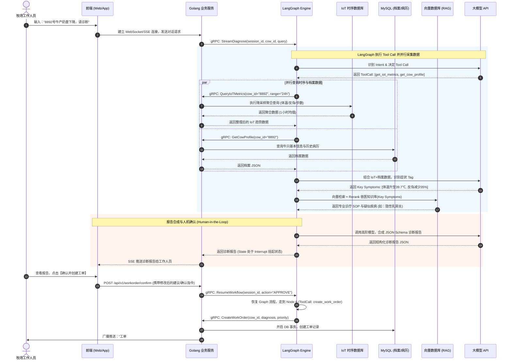
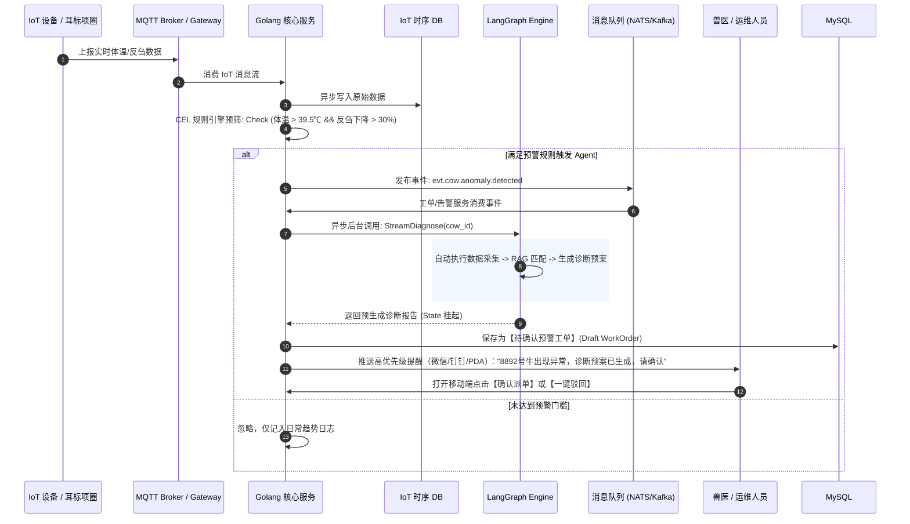

# 智慧牧场 AI Agent 诊断与工单系统架构方案

## 1. 项目背景与设计目标

随着智慧牧场建设的推进，牧场接入了牛只耳标、项圈、计步器、反刍监测设备、体温设备、挤奶厅系统及环境传感器等海量 IoT 设备。当牛只出现生理或行为指标异常时，运营人员需要快速调取牛只档案、历史病历、近期产奶量及 IoT 时序趋势，并结合专业兽医知识库给出诊断结论与处置建议。

本方案旨在打造一个高可靠、高准确度、低成本且具备人机协作（Human-in-the-Loop）机制的 **AI Agent 诊断服务**。

### 核心设计目标
1. **输出高准确度与强安全性**：采用规则引擎预判、向量知识库 (RAG) 对齐、结构化 Schema 约束及后置药品 Guardrails 校验，严控 LLM 幻觉。
2. **成本显著优化 (Token 降本)**：通过 Golang 层前置时序降采样聚合、分级模型路由 (Model Routing) 及 Redis 语义缓存，降低 Token 消耗 60%~80%。
3. **人机协作闭环 (Human-in-the-Loop)**：诊断报告生成后自动中断挂起，由工作人员确认或修正后再一键触发事件创建工单。
4. **高并发与高稳定性**：Golang 处理高频 IoT 事件与工单事务，Python LangGraph 处理复杂 Agent 状态机，结合 Prometheus 全方位监控。

---

## 2. 总体架构设计

系统整体采用 **Golang 核心业务服务 + Python LangGraph Agent 引擎** 的微服务解耦架构。

### 2.1 逻辑架构图

```
┌───────────────────────────────────────────────────────────────────────────────────────────┐
│                                 1. 终端接入层 (Client Layer)                              │
│         [ Web 牧场管理后台 ]         [ 移动端 / 兽医 PDA App ]         [ 消息通知 / 钉钉微信 ]       │
└───────────────────────────────┬───────────────────────────────────────────────────────────┘
                                │ HTTP / WebSocket / SSE
                                ▼
┌───────────────────────────────────────────────────────────────────────────────────────────┐
│                            2. Golang 业务与网关层 (Go Core Layer)                          │
│ ┌─────────────────────────┐  ┌─────────────────────────┐  ┌─────────────────────────────┐ │
│ │  API Gateway / Router   │  │  WebSocket / SSE Push   │  │   Auth & Session Manager    │ │
│ └─────────────────────────┘  └─────────────────────────┘  └─────────────────────────────┘ │
│ ┌─────────────────────────┐  ┌─────────────────────────┐  ┌─────────────────────────────┐ │
│ │ CEL Rule Engine (预筛)   │  │ IoT Data Aggregator(降采样)│  │ WorkOrder Engine (工单引擎) │ │
│ └─────────────────────────┘  └─────────────────────────┘  └─────────────────────────────┘ │
│ ┌───────────────────────────────────────────────────────────────────────────────────────┐ │
│ │                          Internal RPC Gateway (gRPC Client)                           │ │
│ └───────────────────────────────────────────────────────────────────────────────────────┘ │
└───────────────────────────────┬───────────────────────────────────────────────────────────┘
                                │ gRPC (Protobuf)
                                ▼
┌───────────────────────────────────────────────────────────────────────────────────────────┐
│                         3. Python Agent 编排引擎 (LangGraph Engine)                        │
│ ┌───────────────────────────────────────────────────────────────────────────────────────┐ │
│ │                                  LangGraph State Node                                 │ │
│ │  [Node 1: 参数解析] ──> [Node 2: ToolCall数据采集] ──> [Node 3: RAG匹配] ──> [Node 4: 报告合成] │ │
│ └───────────────────────────────────────────────────────────────────────────────────────┘ │
│ ┌─────────────────────────┐  ┌─────────────────────────┐  ┌─────────────────────────────┐ │
│ │ Structured Output Schema│  │ Memory / Checkpointer   │  │ Guardrails (药品/剂量安全校验) │ │
│ └─────────────────────────┘  └─────────────────────────┘  └─────────────────────────────┘ │
│ ┌───────────────────────────────────────────────────────────────────────────────────────┐ │
│ │                           LangSmith Tracing & Evaluation                              │ │
│ └───────────────────────────────────────────────────────────────────────────────────────┘ │
└─────────────┬─────────────────────────────┬─────────────────────────────┬─────────────────┘
              │ Tool Call (gRPC/HTTP)       │ Search                      │ Chat / Embed
              ▼                             ▼                             ▼
┌───────────────────────────┐ ┌───────────────────────────┐ ┌─────────────────────────────┐
│ 4. 数据与存储层 (Data Layer)│ │ 5. 知识库与向量 (Vector)   │ │ 6. 模型层 (LLM Provider)    │
│ ┌───────────────────────┐ │ │ ┌───────────────────────┐ │ │ ┌─────────────────────────┐ │
│ │ TSDB (TDengine/Influx)│ │ │ │ Milvus / Qdrant       │ │ │ │ DeepSeek / Qwen (ToolCall)│ │
│ └───────────────────────┘ │ │ └───────────────────────┘ │ │ └─────────────────────────┘ │
│ ┌───────────────────────┐ │ │ ┌───────────────────────┐ │ │ ┌─────────────────────────┐ │
│ │ MySQL (档案/历史病例)  │ │ │ │ BGE / Reranker Model  │ │ │ │ Claude / GPT-4o (诊断合成)│ │
│ └───────────────────────┘ │ │ └───────────────────────┘ │ │ └─────────────────────────┘ │
│ ┌───────────────────────┐ │ └───────────────────────────┘ └─────────────────────────────┘
│ │ Redis (Session/Cache) │ │
│ └───────────────────────┘ │
└───────────────────────────┘
```

### 2.2 技术栈选型

| 模块 | 技术选型 | 选用理由 |
| :--- | :--- | :--- |
| **业务网关 & 规则引擎** | Golang (Gin/Fiber, `cel-go`) | 高并发、低内存开销，适合高频 IoT 数据过滤与工单事务处理。 |
| **Agent 状态机编排** | Python (`LangGraph`, `LangChain`) | 提供确切图节点状态控制、支持 `interrupt` 人工确认与持久化恢复。 |
| **可观测性与评测** | `LangSmith` + `Prometheus` + `Grafana` | 全链路 Prompt/ToolCall 追踪、Token 成本计算、吞吐与响应延迟监控。 |
| **关系型数据库** | MySQL 8.0 | 存储牛只基本档案、历史病例、工单与 Agent 诊断日志。 |
| **内存数据库与缓存** | Redis 7.0 | 用于 Agent 状态 Checkpoint 暂存、Tool Call 语义缓存、分布式锁。 |
| **时序数据库** | TDengine / InfluxDB | 高效存储与降采样查询体温、反刍、步数等海量 IoT 设备指标。 |
| **向量数据库 (RAG)** | Milvus / Qdrant / PgVector | 存储兽医专业知识库、疾病 SOP 与处方规程，支持混合检索。 |

---

## 3. 服务调用链路设计

系统包含两大核心链路：**工作人员主动对话诊断链路** 与 **IoT 事件驱动告警链路**。

### 3.1 场景一：工作人员主动对话诊断链路 (Sequence Diagram)



### 3.2 场景二：IoT 异常被动告警触发 Agent 链路



### 3.3 gRPC 接口契约定义 (Protobuf)

```protobuf
syntax = "proto3";

package dairy.agent.v1;

option go_package = "proto/agent/v1;agentv1";

service AgentInternalService {
  // 1. 发起或继续 Agent 诊断工作流
  rpc StreamDiagnose (DiagnoseRequest) returns (stream DiagnoseResponse);
  
  // 2. 人工确认/恢复状态机 (Resume Interrupt)
  rpc ResumeWorkflow (ResumeRequest) returns (DiagnoseResponse);
}

message DiagnoseRequest {
  string session_id = 1;
  string cow_id = 2;
  string user_query = 3;
  string trigger_source = 4; // "MANUAL_CHAT" 或 "IOT_ALARM"
}

message DiagnoseResponse {
  string session_id = 1;
  string current_node = 2;   // 当前状态机节点名称
  string status = 3;         // "RUNNING", "AWAITING_HUMAN_CONFIRM", "COMPLETED", "FAILED"
  string payload_json = 4;    // 诊断报告或中间输出内容
}

message ResumeRequest {
  string session_id = 1;
  string action = 2;         // "APPROVE" (确认派单) 或 "REJECT" (驳回/放弃)
  string modified_suggest = 3;// 人工修改后的处置建议 (可选)
  string operator_id = 4;    // 操作人员ID
}
```

---

## 4. 数据库与存储设计

### 4.1 MySQL 数据库结构设计

#### 1. 牛只基本档案表 (`tb_cow_profile`)
```sql
CREATE TABLE `tb_cow_profile` (
  `id` BIGINT UNSIGNED AUTO_INCREMENT PRIMARY KEY COMMENT '自增主键',
  `cow_id` VARCHAR(64) NOT NULL UNIQUE COMMENT '牛只编号/耳标号',
  `pasture_id` VARCHAR(64) NOT NULL COMMENT '所属牧场ID',
  `barn_id` VARCHAR(64) NOT NULL COMMENT '牛舍编号',
  `birth_date` DATE NOT NULL COMMENT '出生日期',
  `lactation_stage` VARCHAR(32) NOT NULL DEFAULT 'EARLY' COMMENT '泌乳阶段 (EARLY:早期, MID:中期, LATE:后期, DRY:干奶期)',
  `parity` INT UNSIGNED NOT NULL DEFAULT 1 COMMENT '胎次',
  `status` TINYINT NOT NULL DEFAULT 1 COMMENT '状态 (1:正常, 2:生病隔离, 3:淘汰)',
  `created_at` DATETIME NOT NULL DEFAULT CURRENT_TIMESTAMP,
  `updated_at` DATETIME NOT NULL DEFAULT CURRENT_TIMESTAMP ON UPDATE CURRENT_TIMESTAMP,
  INDEX `idx_pasture_barn` (`pasture_id`, `barn_id`)
) ENGINE=InnoDB DEFAULT CHARSET=utf8mb4 COMMENT='牛只基本档案表';
```

#### 2. 历史病例记录表 (`tb_cow_medical_history`)
```sql
CREATE TABLE `tb_cow_medical_history` (
  `id` BIGINT UNSIGNED AUTO_INCREMENT PRIMARY KEY,
  `cow_id` VARCHAR(64) NOT NULL COMMENT '牛只编号',
  `disease_name` VARCHAR(128) NOT NULL COMMENT '诊断疾病名称',
  `symptoms` TEXT COMMENT '发病症状描述',
  `treatment_plan` TEXT COMMENT '处置方案及用药记录',
  `veterinarian_id` VARCHAR(64) COMMENT '接诊兽医ID',
  `cured_at` DATETIME COMMENT '治愈时间',
  `created_at` DATETIME NOT NULL DEFAULT CURRENT_TIMESTAMP,
  INDEX `idx_cow_created` (`cow_id`, `created_at`)
) ENGINE=InnoDB DEFAULT CHARSET=utf8mb4 COMMENT='牛只历史病例表';
```

#### 3. 牧场处置工单表 (`tb_work_order`)
```sql
CREATE TABLE `tb_work_order` (
  `id` BIGINT UNSIGNED AUTO_INCREMENT PRIMARY KEY,
  `work_order_no` VARCHAR(64) NOT NULL UNIQUE COMMENT '工单流水号 (如 WO202609040001)',
  `cow_id` VARCHAR(64) NOT NULL COMMENT '关联牛只耳标号',
  `session_id` VARCHAR(64) DEFAULT NULL COMMENT '关联 Agent 会话 ID',
  `source` VARCHAR(32) NOT NULL DEFAULT 'AGENT' COMMENT '来源 (AGENT:AI推荐, MANUAL:手动人工)',
  `priority` VARCHAR(16) NOT NULL DEFAULT 'MEDIUM' COMMENT '优先级 (LOW, MEDIUM, HIGH, URGENT)',
  `suspected_disease` VARCHAR(128) NOT NULL COMMENT '疑似疾病',
  `diagnosis_report_json` JSON NOT NULL COMMENT 'Agent 终审诊断报告全文 JSON',
  `suggested_treatment` TEXT NOT NULL COMMENT '推荐处置建议 (含人工修改后内容)',
  `status` VARCHAR(32) NOT NULL DEFAULT 'PENDING' COMMENT '工单状态 (PENDING:待处理, PROCESSING:处理中, COMPLETED:已完成, CANCELLED:已取消)',
  `operator_id` VARCHAR(64) COMMENT '确认派单人/创建人ID',
  `assignee_id` VARCHAR(64) COMMENT '执行兽医/饲养员ID',
  `created_at` DATETIME NOT NULL DEFAULT CURRENT_TIMESTAMP,
  `updated_at` DATETIME NOT NULL DEFAULT CURRENT_TIMESTAMP ON UPDATE CURRENT_TIMESTAMP,
  INDEX `idx_cow_status` (`cow_id`, `status`),
  INDEX `idx_created` (`created_at`)
) ENGINE=InnoDB DEFAULT CHARSET=utf8mb4 COMMENT='牧场处置工单表';
```

#### 4. Agent 诊断评估与日志表 (`tb_agent_diagnosis_log`)
```sql
CREATE TABLE `tb_agent_diagnosis_log` (
  `id` BIGINT UNSIGNED AUTO_INCREMENT PRIMARY KEY,
  `session_id` VARCHAR(64) NOT NULL UNIQUE COMMENT 'Agent 会话 ID',
  `cow_id` VARCHAR(64) NOT NULL COMMENT '牛只编号',
  `prompt_tokens` INT UNSIGNED NOT NULL DEFAULT 0 COMMENT '消耗 Prompt Token',
  `completion_tokens` INT UNSIGNED NOT NULL DEFAULT 0 COMMENT '消耗 Completion Token',
  `total_cost_usd` DECIMAL(10, 6) NOT NULL DEFAULT 0.000000 COMMENT '预计 Token 成本(美元)',
  `tool_calls_json` JSON COMMENT 'Tool Call 调用记录及返回耗时',
  `rag_docs_json` JSON COMMENT '召回的知识库片段 ID 列表',
  `user_action` VARCHAR(32) DEFAULT NULL COMMENT '人工结果 (APPROVED:确认派单, MODIFIED:修改后派单, REJECTED:驳回)',
  `latency_ms` INT UNSIGNED NOT NULL COMMENT 'Agent 端到端处理耗时(毫秒)',
  `created_at` DATETIME NOT NULL DEFAULT CURRENT_TIMESTAMP,
  INDEX `idx_session` (`session_id`),
  INDEX `idx_cow` (`cow_id`)
) ENGINE=InnoDB DEFAULT CHARSET=utf8mb4 COMMENT='Agent诊断评估日志表';
```

---

### 4.2 Redis 键值结构设计

Redis 主要用于 **Agent 状态机持久化 Checkpoint**、**高频 IoT 状态缓存**、**语义缓存** 及 **并发锁**。

| Key 模式 | 数据结构 | TTL | 说明 |
| :--- | :--- | :--- | :--- |
| `agent:checkpoint:{session_id}` | String / Hash | 7天 | LangGraph State 序列化数据，支持 Interrupt 中断后根据 `session_id` 恢复执行。 |
| `cache:cow:iot:latest:{cow_id}` | Hash | 5分钟 | 记录牛只最新一次上报的体温、反刍、步数及设备在线状态，避免高频打时序 DB。 |
| `cache:agent:semantic:{md5_hash}` | String (JSON) | 24小时 | 语义缓存：针对相同病征 Tag 和 IoT 数据的 Tool Call 与诊断预案缓存，降本增效。 |
| `lock:workorder:create:{cow_id}` | String | 10秒 | 分布式排他锁 (Redlock)，防止短时间内针对同一头牛重复创建并发工单。 |
| `limit:agent:rate:{user_id}` | Sliding Window | 1分钟 | 限流计数器，防止单个账号高频刷 Agent 诊断接口。 |

---

### 4.3 Prometheus 监控指标设计

系统通过 Prometheus 采集 Agent 微服务与 Golang 业务网关的性能、成本与准确度指标。

#### 1. Counter (计数器)

```prometheus
# 1. 大模型 Token 消费总数 (分模型、分类型统计)
agent_token_consumption_total{model="deepseek-v3", type="prompt"} 124500
agent_token_consumption_total{model="claude-3-5-sonnet", type="completion"} 35000

# 2. Agent 诊断请求总数 (按触发源与结果状态)
agent_diagnosis_requests_total{source="MANUAL_CHAT", status="success"} 120
agent_diagnosis_requests_total{source="IOT_ALARM", status="failed"} 2

# 3. 人工确认/派单动作计数 (计算 AI 诊断采纳率)
agent_workorder_action_total{action="APPROVED"} 85
agent_workorder_action_total{action="MODIFIED"} 10
agent_workorder_action_total{action="REJECTED"} 5
```

#### 2. Histogram (直方图)

```prometheus
# 1. Agent 端到端诊断延迟分布 (秒)
agent_diagnosis_duration_seconds_bucket{le="1.0"} 15
agent_diagnosis_duration_seconds_bucket{le="3.0"} 80
agent_diagnosis_duration_seconds_bucket{le="5.0"} 110
agent_diagnosis_duration_seconds_bucket{le="+Inf"} 120

# 2. Tool Call 节点工具调用耗时分布 (秒)
agent_tool_call_duration_seconds_bucket{tool_name="get_iot_metrics", le="0.2"} 95
agent_tool_call_duration_seconds_bucket{tool_name="search_veterinary_kb", le="0.5"} 115
```

#### 3. Gauge (仪表盘)

```prometheus
# 1. 当前处于挂起等待人工确认 (HITL Interrupt) 的 Session 数量
agent_hitl_pending_sessions 8

# 2. IoT 异常数据过滤率 (Golang CEL 规则引擎拦截比例)
iot_rule_engine_filtered_ratio 0.92
```

---

## 5. 成本优化与输出准确度保障细节

### 5.1 成本控制 (Cost Reduction) 实施细节
1. **Golang 前置数据降维**：
   - IoT 设备每 10 秒上报一次数据，1 天约 8,640 个点。
   - Golang 在响应 `get_iot_metrics` Tool 时，将其聚合成：**“近24h体温最高值/最低值”、“反刍降幅%”、“活动量偏移标准差”**。Token 占用从 20k 降至 < 800 Token。
2. **模型分级路由 (Model Routing)**：
   - **Tool Call & 意图识别**：选用低单价模型（如 DeepSeek-V3 / Qwen-2.5-Coder，约 $0.14 / 1M token）。
   - **最终诊断报告合成**：仅在节点 4 处调用高阶模型（如 Claude 3.5 Sonnet / GPT-4o）。

### 5.2 准确度与安全护栏 (Guardrails) 实施细节
1. **结构化 Pydantic 强制约束**：
   - 要求 Agent 输出固定 JSON，拒绝任何自由文本段落，避免缺少关键字段。
2. **兽医处方 Guardrail 校验 (Go 侧实现)**：
   - 当 Agent 生成 `suggested_treatment` 时，Golang 工单引擎拦截校验：
     - 是否包含禁用兽药名？
     - 给药剂量是否超过《牧场标准用药手册》界限？
   - 若校验不通过，自动触发异常告警并重定向给人工兽医复核。
